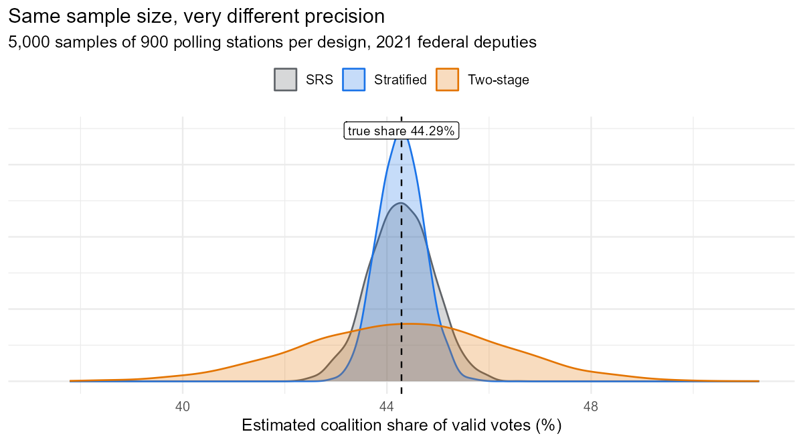
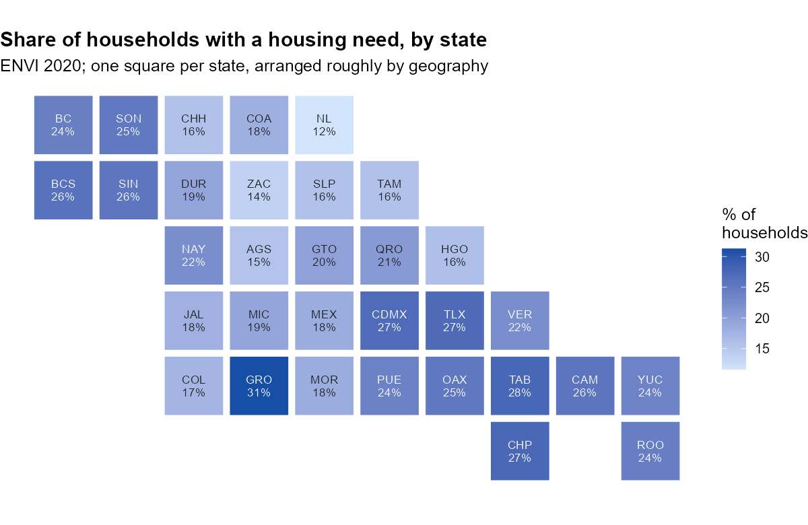

# Survey sampling with Mexican public data

**Two everyday problems of a statistics office, solved with official data and design-based inference in R.**

📊 [Full report](https://amaugomez.github.io/survey-sampling-mexico/)

*Based on a 2022 class project with Daniel Franco Zárraga and Jorge Sandoval Mendoza (Survey Sampling, Facultad de Ciencias, UNAM); re-implemented and extended in 2026. Original documents in [`archive/2022-class-project/`](archive/2022-class-project/).*

---

## 1. Designing a quick count (INE 2021)

Population: all **163,666 polling stations** of the 2021 federal deputies election. Parameter: the Morena–PT–PVEM coalition's share of valid votes (**44.29%**). Three ways to choose 900 stations, compared with exact (linearised) variances and 5,000 simulated samples each:

| Design | SE (pp) | 95% CI coverage | Design effect | Effective n |
|---|---|---|---|---|
| Simple random sample | 0.61 | 94.5% | 1.00 | 900 |
| **Stratified by district** (300 × 3) | **0.44** | 94.8% | **0.52** | **1,723** |
| Two-stage by circumscription (5 × 6 districts × 30) | 1.97 | 93.7% | 10.35 | 87 |



The vote share varies much more between districts than within them. Stratifying by district removes that variation; sampling only 30 districts puts it back and multiplies the variance by ten. Spreading the same 900 stations over more districts (30 × 6) brings the design effect down to 1.6.

## 2. Housing need from the ENVI 2020 survey (INEGI)

Households that need to rent, buy or build a home, estimated from the ENVI 2020 microdata with its stratified two-stage design (552 strata, 8,278 PSUs, expansion factors) using the `survey` package:

- **7,628,562 households (21.1%, 90% CI 20.6–21.5%)**, from 11.6% in Nuevo León to 31.3% in Guerrero.
- **Validated against INEGI's official tables:** all 33 estimates (national and 32 states) and their standard errors match exactly.



## Reproduce it

```r
Rscript run_all.R   # downloads ~40 MB of public data from INE and INEGI on the first run
```

| Script | What it does |
|---|---|
| `R/01_get_data.R` | Downloads the official INE and INEGI files |
| `R/02_ine_frame.R` | Builds the sampling frame (coalition votes, valid votes, districts, circumscriptions) |
| `R/03_ine_designs.R` | Ratio estimator, closed-form linearised variances, variance estimators, 5,000-sample simulation, two-stage allocation |
| `R/04_envi_estimates.R` | ENVI survey design, national and state estimates, check against INEGI's tables |
| `R/05_figures.R` | Figures |

## Skills shown

Survey sampling design · Horvitz–Thompson and ratio estimation · Taylor linearisation · design effects · Monte Carlo simulation · complex survey analysis (`survey`) · official statistics (INE, INEGI) · R · Quarto

---

Code: MIT License. Aaron Mauricio Gómez Jiménez · [LinkedIn](https://www.linkedin.com/in/amaugomezjimenez) · [ORCID](https://orcid.org/0009-0003-1099-0431)
