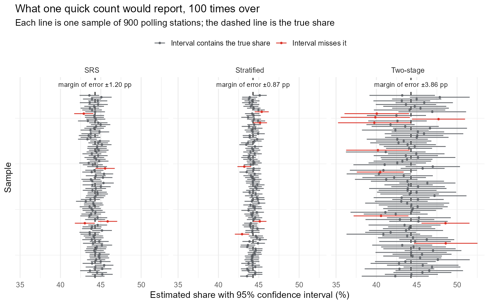
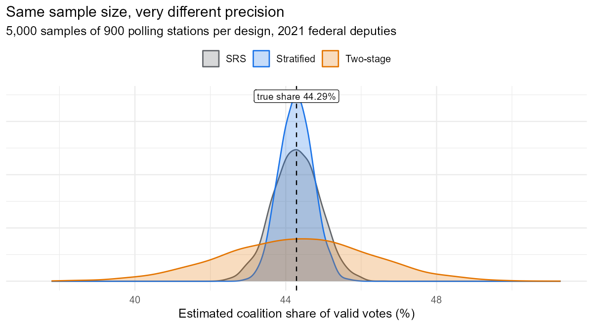
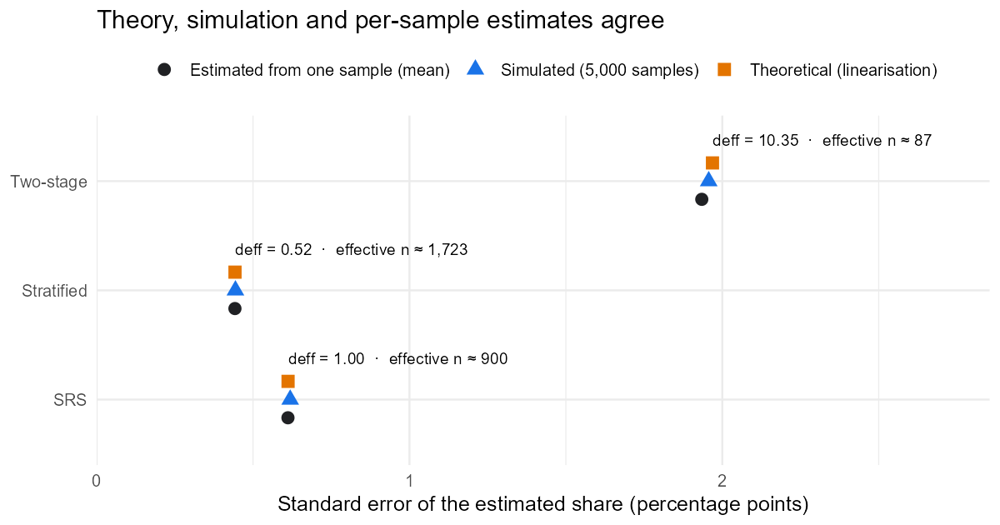
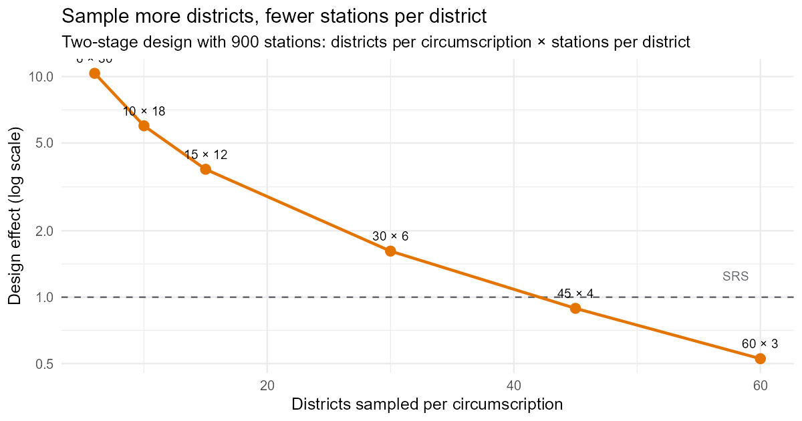
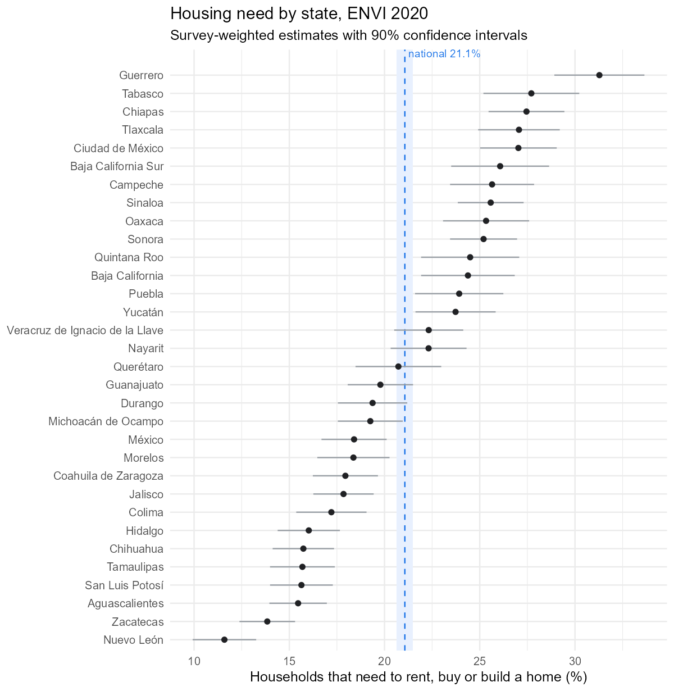
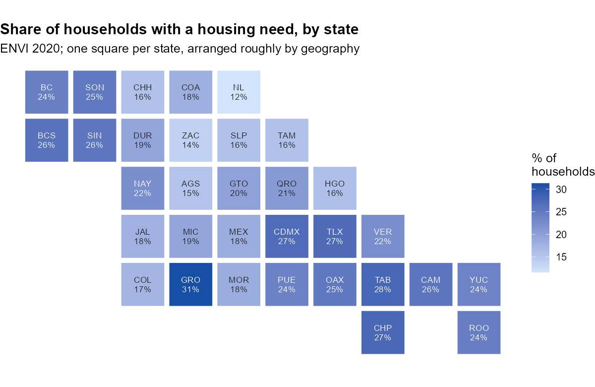

```{r}
#| include: false
library(readr); library(dplyr); library(knitr)
fr    <- read_csv("results/ine_frame_summary.csv", show_col_types = FALSE)
cmp   <- read_csv("results/ine_design_comparison.csv", show_col_types = FALSE)
alloc <- read_csv("results/ine_two_stage_allocation.csv", show_col_types = FALSE)
envi  <- read_csv("results/envi_housing_need.csv", show_col_types = FALSE)
chk   <- read_csv("results/envi_check_vs_inegi.csv", show_col_types = FALSE)
info  <- read_csv("results/envi_design_info.csv", show_col_types = FALSE)
nat   <- filter(envi, ent == 0)
d     <- function(x) cmp$deff[cmp$design == x]
se    <- function(x) cmp$se_theoretical_pp[cmp$design == x]
f0    <- function(x) format(round(x), big.mark = ",")
mg    <- function(x) cmp$margin95_pp[cmp$design == x]
```

**2022 (original team project) · revised November 2026**

*Based on a 2022 class project with Daniel Franco Zárraga and Jorge Sandoval Mendoza (Survey Sampling, Facultad de Ciencias, UNAM); re-implemented and extended in 2026. The [original documents](https://github.com/AMauGomez/survey-sampling-mexico/tree/main/archive/2022-class-project) are in the repository.*

```{=html}
<style>
.flow{display:flex;flex-wrap:wrap;gap:.6rem;margin:1.2rem 0 .4rem;align-items:stretch}
.flow .step{flex:1 1 160px;border:1px solid #dadce0;border-radius:10px;padding:.75rem .8rem;background:#fafbfc}
.flow .step .n{font-size:.72rem;letter-spacing:.06em;text-transform:uppercase;color:#5f6368}
.flow .step .big{font-size:1.35rem;font-weight:700;line-height:1.15;margin:.2rem 0}
.flow .step .txt{font-size:.85rem;color:#3c4043;line-height:1.3}
.flow .step.hl{border-color:#1a73e8;background:#e8f0fe}
.keybox{border-left:4px solid #1a73e8;background:#f8f9fa;padding:.8rem 1rem;margin:1rem 0;border-radius:4px}
.keybox ul{margin-bottom:0}
</style>
```

```{r}
#| results: asis
cat(sprintf('<div class="flow">
 <div class="step"><div class="n">Population</div><div class="big">%s</div><div class="txt">polling stations, 2021 federal deputies (INE)</div></div>
 <div class="step hl"><div class="n">Margin of error, 900 stations</div><div class="big">±%.2f vs ±%.1f</div><div class="txt">percentage points: stratified by district vs two-stage clusters</div></div>
 <div class="step"><div class="n">Design effect</div><div class="big">%.2f vs %.1f</div><div class="txt">same sample size, 3 designs × 5,000 simulated samples</div></div>
 <div class="step hl"><div class="n">ENVI 2020</div><div class="big">33 / 33</div><div class="txt">estimates match INEGI\'s official tables exactly</div></div>
</div>', f0(fr$polling_stations), mg("Stratified"), mg("Two-stage"), d("Stratified"), d("Two-stage")))
```

## Summary

Two problems that a statistics office solves every day:

1. **Designing a sample.** If a new federal election were held, how should 900 polling stations be chosen to estimate the vote share of the Morena–PT–PVEM coalition as precisely as possible? Using the full 2021 results as the population, I compare three designs exactly (variance formulas) and by simulation (5,000 samples each).
2. **Analysing a complex survey.** How many Mexican households need to rent, buy or build a home? I estimate it from the ENVI 2020 microdata, using INEGI's stratified two-stage design, and reproduce the official figures exactly.

**The headline:** with the same 900 polling stations, a sample stratified by district estimates the coalition's national vote share within **±`r sprintf("%.2f", mg("Stratified"))` percentage points**, while a sample concentrated in 30 districts gets only **±`r sprintf("%.1f", mg("Two-stage"))` points**. Same sample size, a variance about `r round(d("Two-stage") / d("Stratified"))` times larger: the design, not the number of stations, decides the precision.

```{r}
#| fig-cap: "The first 100 of 5,000 simulated quick counts per design. Each line is one sample's estimate and 95% confidence interval; red intervals miss the true share."

```

::: {.keybox}
**What this shows**

- **Design-based inference:** Horvitz–Thompson weights, the ratio estimator and its variance by Taylor linearisation, written from scratch and checked by simulation.
- **Why design choices matter:** with the same 900 stations, stratifying by district halves the variance of simple random sampling, while sampling few districts multiplies it by ten.
- **Working with real survey microdata:** strata, primary sampling units and expansion factors with the `survey` package, validated number by number against INEGI's published tables.
:::

# Part 1. Designing a quick count

## The population and the parameter

The population is every polling station (*casilla*) in the 2021 election for federal deputies: **`r f0(fr$polling_stations)` stations in `r fr$districts` districts**, grouped in `r fr$circumscriptions` electoral circumscriptions. For each station $k$:

- $y_k$ = votes for the coalition (Morena, PT, PVEM, or any of their joint combinations on the ballot);
- $z_k$ = valid votes (total votes minus null votes).

The parameter is the coalition's share of valid votes, a ratio of two population totals:

$$
R = \frac{t_y}{t_z} = \frac{\sum_{k \in U} y_k}{\sum_{k \in U} z_k} = `r sprintf("%.3f", fr$coalition_share_pct)`\%.
$$

## Three designs with 900 stations each

| Design | How the 900 stations are chosen | Inclusion probability $\pi_k$ |
|---|---|---|
| **I. Simple random sample** | 900 stations at random from the whole country | $n/N$ |
| **II. Stratified by district** | 3 stations at random in each of the 300 districts | $3/N_h$ in district $h$ |
| **III. Two-stage by circumscription** | In each of the 5 circumscriptions, 6 districts at random; in each selected district, 30 stations at random | $\dfrac{6}{M_c} \cdot \dfrac{30}{N_i}$ |

## Estimator and variance

Both totals are estimated with Horvitz–Thompson weights $w_k = 1/\pi_k$, and the share with the **ratio estimator**:

$$
\hat R = \frac{\hat t_y}{\hat t_z} = \frac{\sum_{k \in s} w_k\, y_k}{\sum_{k \in s} w_k\, z_k}.
$$

The denominator is random too (the number of valid votes in the sample varies), so $\hat R$ is not linear. A first-order Taylor expansion makes it linear:

$$
\hat R - R \approx \sum_{k \in s} w_k\, u_k, \qquad u_k = \frac{y_k - R\, z_k}{t_z},
$$

so the variance of $\hat R$ is the variance of the Horvitz–Thompson estimator of the total of $u$. For each design this has a closed form:

$$
\begin{aligned}
V_{\text{I}} &= N^2\Big(1-\tfrac{n}{N}\Big)\frac{S_u^2}{n}, \qquad
V_{\text{II}} = \sum_{h=1}^{300} N_h^2\Big(1-\tfrac{n_h}{N_h}\Big)\frac{S_{u,h}^2}{n_h}, \\
V_{\text{III}} &= \sum_{c=1}^{5}\left[ M_c^2\Big(1-\tfrac{m_c}{M_c}\Big)\frac{S_{T,c}^2}{m_c}
 + \frac{M_c}{m_c}\sum_{i \in c} N_i^2\Big(1-\tfrac{n_i}{N_i}\Big)\frac{S_{u,i}^2}{n_i} \right],
\end{aligned}
$$

where $S_{T,c}^2$ is the variance of the district totals $T_i = \sum_{k \in i} u_k$ within circumscription $c$: the **between-district** component. In each simulated sample, the same formulas with sample variances (and $\hat R$ in place of $R$) give an estimated variance and a 95% confidence interval.

## Results

```{r}
cmp |>
  transmute(Design = label,
            `Mean of estimates (%)` = sprintf("%.2f", mean_estimate_pct),
            `Bias (pp)` = sprintf("%+.3f", bias_pp),
            `SE: theory (pp)` = sprintf("%.3f", se_theoretical_pp),
            `SE: simulation (pp)` = sprintf("%.3f", se_simulated_pp),
            `95% CI coverage` = sprintf("%.1f%%", ci95_coverage_pct),
            `Design effect` = sprintf("%.2f", deff),
            `Effective n` = f0(effective_n)) |>
  kable(caption = sprintf("5,000 samples per design. True share: %.3f%%. pp = percentage points.", fr$coalition_share_pct))
```

```{r}
#| fig-cap: "Distribution of the estimated share over 5,000 samples of each design."

```

- **All three designs are essentially unbiased** (bias below 0.01 percentage points). The ratio estimator's bias is of order $1/n$ and negligible here.
- **Theory and simulation agree:** the linearised variance matches the spread of the 5,000 estimates, and the variance estimated from a single sample gives confidence intervals with close to nominal coverage.
- **Precision is what differs**, by a factor of more than four in standard error.

```{r}
#| fig-cap: "Standard errors from the closed-form variance, from the simulation and estimated from each sample."

```

## Why the designs differ

The coalition's share varies a lot **between districts** and much less **within** a district. That single fact explains the results:

- **Stratifying by district** removes the between-district variation from the error: every district is in the sample, so only within-district variation remains. The design effect is `r sprintf("%.2f", d("Stratified"))`: 900 stratified stations are worth about `r f0(cmp$effective_n[cmp$design == "Stratified"])` stations sampled at random.
- **Sampling only 30 districts** (design III) puts the between-district variation back, and amplifies it: 30 stations from the same district are similar to each other (positive intraclass correlation), so they add little new information. The design effect is `r sprintf("%.1f", d("Two-stage"))`: the 900 stations are worth about `r f0(cmp$effective_n[cmp$design == "Two-stage"])`.

Cluster sampling is still used in practice because visiting a few areas is cheaper. The question is how to split the sample between the two stages. The 2022 report suggested sampling **more districts and fewer stations per district**; the variance formula confirms it:

```{r}
#| fig-cap: "Design effect of the two-stage design for different splits of the same 900 stations. At 60 × 3 almost every district is in the sample and the design approaches design II."

```

```{r}
alloc |>
  transmute(`Districts per circumscription` = districts_per_circ,
            `Stations per district` = stations_per_district,
            `SE (pp)` = sprintf("%.2f", se_pp),
            `Design effect` = sprintf("%.2f", deff)) |>
  kable(caption = "Two-stage design with 900 stations: exact standard error and design effect by allocation.")
```

With 30 districts × 6 stations per circumscription the design effect falls from `r sprintf("%.1f", alloc$deff[alloc$districts_per_circ == 6])` to `r sprintf("%.1f", alloc$deff[alloc$districts_per_circ == 30])`.

# Part 2. Housing need from the ENVI 2020 survey

## The survey design

The Encuesta Nacional de Vivienda (ENVI) 2020 interviewed **`r f0(info$households_in_sample)` households**. Its design is probabilistic, two-stage, stratified and clustered: `r info$strata` design strata (`EST_DIS`), `r f0(info$psus)` primary sampling units (`UPM_DIS`) and an expansion factor for each household (`FACTOR`). Ignoring this structure and treating the households as a simple random sample would give wrong standard errors.

The question analysed is P3A1.1: *Does anyone in this household need, or plan, to rent, buy or build a home, apart from the one they live in now?*

```{r}
#| echo: true
#| eval: false
#| code-fold: false
library(survey)
des <- svydesign(ids = ~UPM_DIS, strata = ~EST_DIS, weights = ~FACTOR,
                 data = envi, nest = TRUE)
svytotal(~need, des)                                  # number of households
svymean(~need, des, deff = TRUE)                      # share and design effect
svyby(~need, ~ENT, des, svymean)                      # by state
```

## National estimate

```{r}
#| results: asis
cat(sprintf("**%s households** had a housing need in 2020 (90%% CI %s to %s), **%.1f%%** of the %s households in the country (90%% CI %.1f%% to %.1f%%). The design effect of the national share is %.2f: the clustered design is about half as efficient as a simple random sample of the same size, a typical value for household surveys.",
            f0(nat$need), f0(nat$need_lo), f0(nat$need_hi), nat$pct, f0(nat$households),
            nat$pct_lo, nat$pct_hi, nat$deff))
```

## Validation against INEGI's official tables

INEGI publishes this indicator in the ENVI 2020 basic tabulations (Cuadro 5.1), with standard errors and 90% intervals. My estimates reproduce them **exactly** for the country and all 32 states:

```{r}
chk |>
  filter(ent %in% c(0, 9, 12, 19)) |>
  transmute(Area = state,
            `Households with need (this analysis)` = f0(need), `INEGI` = f0(need_inegi),
            `% (this analysis)` = sprintf("%.2f", pct), `% INEGI` = sprintf("%.2f", pct_inegi),
            `SE of % (this analysis)` = sprintf("%.3f", pct_se), `SE INEGI` = sprintf("%.3f", pct_se_inegi)) |>
  kable(caption = sprintf("Selected rows. Across all 33 rows, the largest difference is %s households in the totals and %.1e percentage points in the shares; the ratio of standard errors of the shares is %.3f–%.3f. Full comparison in results/envi_check_vs_inegi.csv.",
                          f0(info$max_abs_diff_households), info$max_abs_diff_pct_pp,
                          info$se_pct_ratio_min, info$se_pct_ratio_max))
```

## Results by state

```{r}
#| fig-cap: "Share of households with a housing need, by state, with 90% confidence intervals. The shaded band is the national 90% interval."

```

```{r}
#| fig-cap: "The same estimates on a tile map of Mexico."

```

```{r}
#| results: asis
hi <- envi |> filter(ent != 0) |> arrange(desc(pct)) |> slice(1)
lo <- envi |> filter(ent != 0) |> arrange(pct) |> slice(1)
cat(sprintf("Housing need ranges from **%.1f%% in %s** to **%.1f%% in %s**, and their intervals do not overlap with the national one. All 33 estimates have a coefficient of variation below 15%%, INEGI's threshold for high precision (largest: %.1f%%).",
            lo$pct, lo$state, hi$pct, hi$state, max(envi$cv_pct)))
```

# About this project

**2022 (team):** class project for Survey Sampling (semester 2022-2, Facultad de Ciencias, UNAM; instructor Dr. Gonzalo Pérez de la Cruz), by Daniel Franco Zárraga, Aaron Mauricio Gómez Jiménez and Jorge Sandoval Mendoza. [Original documents](https://github.com/AMauGomez/survey-sampling-mexico/tree/main/archive/2022-class-project).

**2026 (Aaron Mauricio Gómez Jiménez):** re-implemented from scratch and extended:

- reproducible download of the official INE and INEGI data;
- closed-form linearised variances for the three designs, variance estimators and confidence-interval coverage, checked against 5,000 simulated samples per design;
- the allocation analysis for the two-stage design;
- the ENVI 2020 analysis with the `survey` package, validated against INEGI's published estimates and standard errors.

## Reproduce it

```bash
Rscript run_all.R   # downloads ~40 MB of public data on the first run; about a minute after that
```

Data: INE, *Cómputos Distritales 2021*, federal deputies ([computos2021.ine.mx](https://computos2021.ine.mx/base-de-datos)); INEGI, *Encuesta Nacional de Vivienda (ENVI) 2020*, open data and basic tabulations ([inegi.org.mx](https://www.inegi.org.mx/programas/envi/2020/)).
